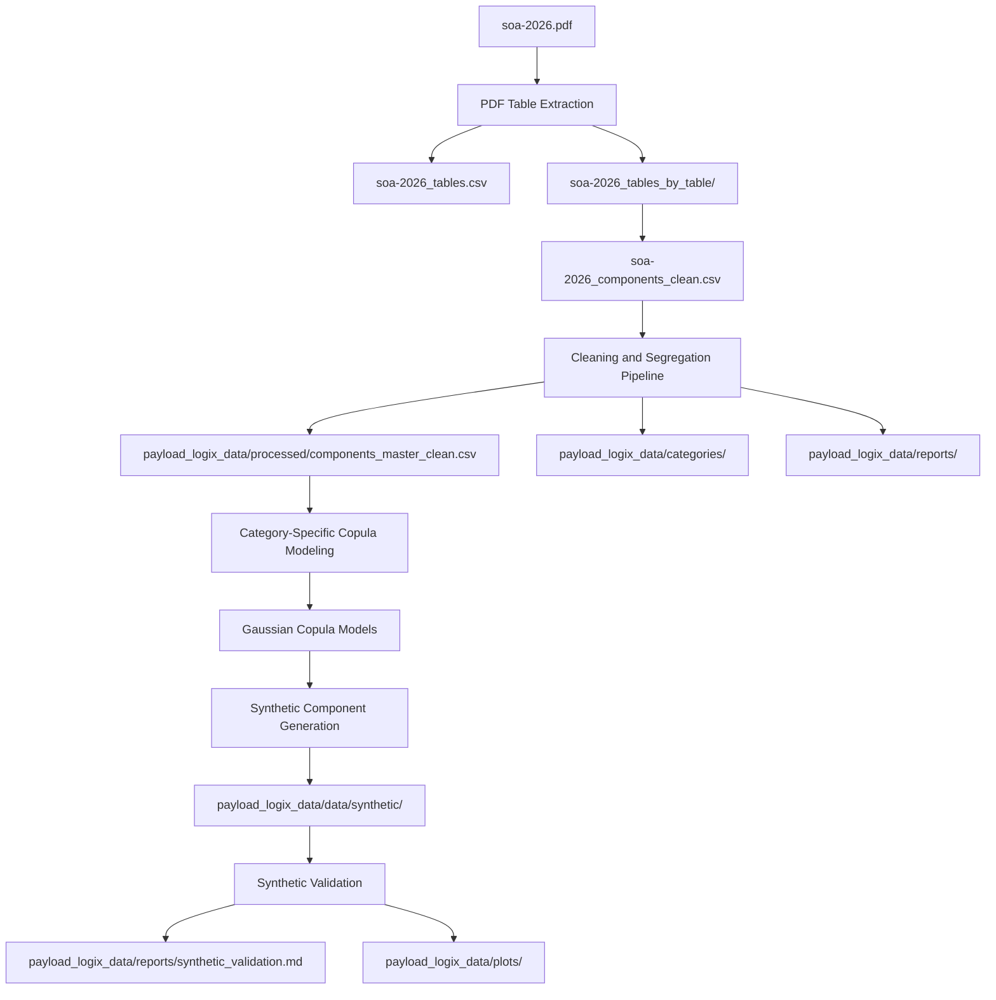
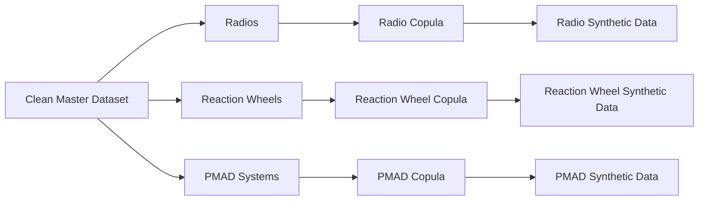
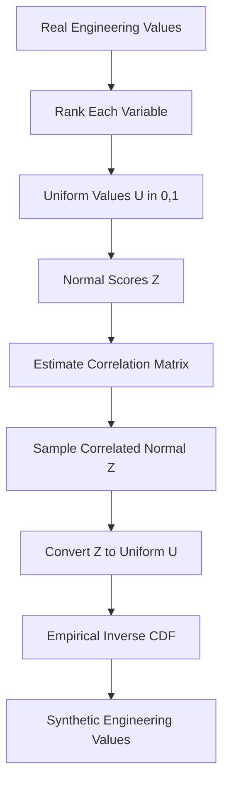

# Payload-Logix Data Pipeline Explanation

Project: **Payload-Logix: PyTorch Agents for Cross-Organizational Satellite Payload Integration Workflows and Resource Allocation**

This document explains the data work completed so far, from NASA PDF table extraction through cleaned component datasets and the first category-specific copula-based synthetic data generation stage.

The goal so far has been to create a traceable, explainable, academically defensible data foundation for later Payload-Logix experiments. No neural generative model, agent integration, Kafka, Redis, LangGraph, or orchestration layer has been added yet.

## 1. Source Data

The original source document was:

`soa-2026.pdf`

This PDF is NASA's **State of the Art - Small Spacecraft Technology** report. It contains many spacecraft technology tables covering components, systems, vendors, performance specifications, dimensions, power, mass, flight heritage, and related engineering information.

The PDF tables were extracted into CSV format so they could be used for structured data analysis.

## 2. Overall Workflow

The completed workflow has three major stages:

1. PDF table extraction
2. Data cleaning and category segregation
3. Category-specific Gaussian copula modeling and synthetic data validation



## 3. PDF Table Extraction

The PDF was inspected and table extraction was performed using `pdfplumber` in a temporary Python environment.

The raw extraction found many tables, but PDFs often produce noisy table detections. Some figure captions, body text blocks, and diagrams can be incorrectly detected as tables.

To reduce noise, the extraction kept tables that had recognizable `Table ...` captions and their continuation pages.

Generated files:

- `soa-2026_tables.csv`
- `soa-2026_tables_index.csv`
- `soa-2026_tables_by_table/`

Extraction summary:

- Extracted `2,234` table rows
- Detected `109` unique table titles
- Created `109` per-table CSV files

The master extraction file used generic columns because the NASA PDF contains many unrelated tables with different schemas.

Example:

- One table may describe antennas using `Manufacturer`, `Product`, `Mass`, `Dimensions`, and `Frequency Band`
- Another table may describe batteries using `Specific Energy`, `Voltage`, and `Capacity`
- Another table may describe reaction wheels using `Mass`, `Power`, `Torque`, and `Momentum Capacity`

Because of this schema variation, the per-table CSVs were more useful for building a cleaner component-focused dataset.

## 4. Component-Focused Dataset Creation

A cleaner combined component dataset was created:

`soa-2026_components_clean.csv`

This file contains approximately `961` spacecraft/component records.

The goal was to keep only component-relevant rows and standardize them under common high-level fields.

Common fields included:

- `category`
- `component_name`
- `manufacturer`
- `component_type`
- `mass`
- `power`
- `dimensions`
- `volume`
- `performance_or_capacity`
- `frequency_or_band`
- `voltage_or_energy`
- `accuracy_or_pointing`
- `radiation_tolerance`
- `flight_heritage_or_orbit`
- `propellant`
- `technology_or_material`
- `notes`

This dataset was not treated as fully clean numerical data yet. It still contained many engineering values as text because NASA tables often express values with units, ranges, inequalities, and mixed descriptions.

Examples:

- `250 g`
- `2.5 kg`
- `10-20 W`
- `<5 W`
- `mission dependent`
- `10 x 20 x 30 cm`
- `2 W @ 100 K; 5 W @ 150 K`

## 5. Cleaning and Segregation Pipeline

A preprocessing pipeline was implemented here:

`payload_logix_data/scripts/clean_and_segregate.py`

This script created the following structure:

```text
payload_logix_data/
    raw/
        soa-2026_components_raw.csv
    processed/
        components_master_clean.csv
    categories/
        <category>.csv
    reports/
        data_profile.md
        missingness_report.md
        category_summary.csv
        copula_candidate_analysis.md
        review_flags.csv
    schemas/
        column_mapping.json
        category_mapping.json
    scripts/
        clean_and_segregate.py
```

### 5.1 Raw Data Preservation

The original `soa-2026_components_clean.csv` was not overwritten.

A raw preserved copy was created:

`payload_logix_data/raw/soa-2026_components_raw.csv`

This is important because the pipeline must be traceable. If later processing decisions are questioned, the raw input used by the pipeline is still available.

### 5.2 Column Name Cleaning

Column names were converted to simple `snake_case` names.

For example:

| Original | Cleaned |
|---|---|
| `component_name` | `component_name` |
| `performance_or_capacity` | `performance_or_capacity` |
| `flight_heritage_or_orbit` | `flight_heritage_or_orbit` |

The mapping was saved in:

`payload_logix_data/schemas/column_mapping.json`

No column meaning was changed.

### 5.3 Missing Value Standardization

Obvious missing markers were standardized.

Examples treated as missing:

- empty strings
- `-`
- `--`
- `N/A`
- `NA`
- `NaN`

Important decision:

No engineering measurements were imputed.

That means missing mass, power, volume, or dimension values were not replaced with zero, mean, median, random values, or fabricated estimates.

This matters because arbitrary imputation would create fake engineering information and bias later statistical modeling.

### 5.4 Engineering Value Parsing

The pipeline conservatively parsed numerical engineering values only when it was safe.

Examples:

| Raw value | Cleaned representation |
|---|---|
| `250 g` | `mass_kg = 0.25` |
| `2.5 kg` | `mass_kg = 2.5` |
| `10-20 W` | `power_min_w = 10`, `power_max_w = 20` |
| `<5 W` | value retained with inequality relation |

For ambiguous or mixed values, the raw text was preserved and the record was flagged for review.

Examples not collapsed into one number:

- `2 W @ 100 K; 5 W @ 150 K`
- values with multiple contexts
- qualitative values like `mission dependent`
- unsupported or unclear units

### 5.5 Dimension Handling

Dimensions were parsed only when they had a clear three-dimensional format.

Example:

`10 x 20 x 30 cm`

produced:

- `dimension_length_cm = 10`
- `dimension_width_cm = 20`
- `dimension_height_cm = 30`
- `dimension_volume_cm3 = 6000`

The pipeline did not invent conversions for formats like `3U` unless the source table clearly supported direct interpretation.

### 5.6 Missingness Indicators

Simple availability flags were added:

- `mass_available`
- `power_available`
- `volume_available`
- `dimensions_available`
- `performance_available`

These flags indicate whether usable information exists. They do not impute missing values.

### 5.7 Category Segregation

The cleaned master dataset was split into one CSV per component category:

`payload_logix_data/categories/<category>.csv`

Category counts were saved in:

`payload_logix_data/reports/category_summary.csv`

The dataset contained `43` categories.

Top categories included:

| Category | Records |
|---|---:|
| Radios | 117 |
| Solar Array Panel Products | 115 |
| Antennas | 92 |
| High Heritage Miniature Reaction Wheels | 66 |
| Power Management And Distribution System Products | 49 |
| High Heritage Magnetic Torquers | 38 |
| Commercial Sun Sensors | 36 |
| Star Trackers Suitable For Small Spacecraft | 31 |
| Commercial Actuator Mechanisms | 30 |

### 5.8 Cleaning Pipeline Results

Final cleaning result:

- Original records: `961`
- Cleaned records: `961`
- Records deleted: `0`
- Categories: `43`

Important missingness statistics:

| Field | Missing Count | Missing Percent |
|---|---:|---:|
| component_name | 27 | 2.81% |
| manufacturer | 333 | 34.65% |
| mass | 235 | 24.45% |
| power | 284 | 29.55% |
| dimensions | 594 | 61.81% |
| volume | 887 | 92.30% |
| performance_or_capacity | 351 | 36.52% |
| frequency_or_band | 728 | 75.75% |
| voltage_or_energy | 891 | 92.72% |
| accuracy_or_pointing | 849 | 88.35% |

Normalized engineering fields produced:

| Field | Usable Values |
|---|---:|
| mass_kg | 657 |
| mass_min_kg | 21 |
| mass_max_kg | 21 |
| power_w | 562 |
| power_min_w | 54 |
| power_max_w | 54 |
| volume_cm3 | 65 |
| volume_min_cm3 | 2 |
| volume_max_cm3 | 2 |
| dimension_volume_cm3 | 217 |

Manual review flags were saved in:

`payload_logix_data/reports/review_flags.csv`

Flag summary:

| Reason | Count |
|---|---:|
| statistically_extreme_iqr_3x | 245 |
| review_unparsed_dimensions | 150 |
| review_unsupported_unit | 116 |
| negative_engineering_value | 7 |

Important note:

Flagged records were not deleted. They remain available for inspection because extreme engineering values may be real spacecraft components rather than errors.

## 6. Copula Readiness Analysis

Before fitting any copula, the cleaned dataset was analyzed category by category.

The purpose was to determine which categories had enough jointly observed numerical variables for possible modeling.

This report was generated:

`payload_logix_data/reports/copula_candidate_analysis.md`

The analysis checked:

- number of records per category
- numerical variables available
- missingness per variable
- number of usable observations
- number of unique values
- whether values appeared continuous enough
- variable pairs with enough jointly observed data

No copulas were fitted during this preprocessing stage.

Categories identified as suitable for later copula investigation included:

- Antennas
- Radios
- High Heritage Miniature Reaction Wheels
- Power Management And Distribution System Products
- Commercial Sun Sensors
- GPS Receivers For Small Spacecraft
- Gyros Available For Small Spacecraft
- High Heritage Magnetic Torquers
- Star Trackers Suitable For Small Spacecraft
- several propulsion categories

## 7. Category-Specific Copula Modeling Stage

After the cleaning pipeline was complete, the next stage was implemented separately.

New scripts:

```text
payload_logix_data/copula/
    fit_copula.py
    generate_synthetic.py
    validate_synthetic.py
```

New generated folders and outputs:

```text
payload_logix_data/
    copula/
        models/
        modeling_data/
    data/
        synthetic/
    reports/
        copula_results.md
        synthetic_validation.md
    plots/
```

The existing preprocessing pipeline was not modified.

## 8. Why Category-Specific Modeling?

Satellite components are not one homogeneous population.

A radio, a reaction wheel, and a power management unit follow different engineering relationships.

For example:

- Radio mass may relate to physical package size and communication capability
- Reaction wheel mass may relate to power and momentum capacity
- PMAD systems may relate to mass, power handling, and volume

Combining all categories into one statistical model would mix unrelated engineering regimes.

Therefore, the copula modeling was performed separately by category.



## 9. Selected Categories

The requested initial categories were:

1. Radios
2. High Heritage Miniature Reaction Wheels
3. Power Management And Distribution System Products

All three had sufficient jointly observed numerical data, so no replacement category was needed.

Modeled categories:

| Category | Records in Category | Usable Complete Observations | Synthetic Rows |
|---|---:|---:|---:|
| Radios | 117 | 97 | 485 |
| High Heritage Miniature Reaction Wheels | 66 | 53 | 265 |
| Power Management And Distribution System Products | 49 | 38 | 190 |

Synthetic data was generated at approximately `5x` the number of usable real observations.

## 10. Selected Variables

Only numerical variables produced by the cleaning pipeline were used.

No IDs, names, text fields, raw descriptions, or categorical fields were modeled.

Selected variables:

| Category | Variables Used |
|---|---|
| Radios | `mass_kg`, `dimension_volume_cm3` |
| High Heritage Miniature Reaction Wheels | `mass_kg`, `power_w` |
| Power Management And Distribution System Products | `mass_kg`, `power_w`, `volume_cm3` |

Important radio decision:

`Radios.power_w` was not modeled because validation showed negative values in that field. These likely come from source table values such as dBm or other transmitter power representations being extracted into a field named `power_w`. Since negative watts are physically invalid, that variable was excluded from radio copula modeling.

This is a defensible academic choice because the model should not learn from unsafe normalized values.

## 11. What Is a Copula?

A copula is a statistical tool that separates a multivariable distribution into two parts:

1. The marginal distribution of each variable
2. The dependence structure between variables

For example, suppose we model component `mass_kg` and `power_w`.

The marginal distributions answer:

- What values does mass usually take?
- What values does power usually take?

The copula answers:

- When mass is high, does power also tend to be high?
- How strongly are the variables related?

This separation is useful because engineering variables are often not normally distributed. Mass and power can be skewed, bounded at zero, and have extreme values.

## 12. Gaussian Copula Method

The baseline model used here is a **Gaussian copula with empirical marginals**.

It was chosen because it is simple, interpretable, and suitable for an academic first implementation.

The method follows these steps:

1. Select complete rows for the chosen numerical variables
2. Estimate each marginal distribution empirically using ranks
3. Convert each value to an approximate uniform value between 0 and 1
4. Convert uniform values into standard normal scores
5. Estimate the correlation matrix of those normal scores
6. Sample new correlated normal values
7. Convert sampled normal values back to uniform values
8. Convert uniform values back to engineering units using empirical inverse CDFs



### 12.1 CDF Transformation

For each variable, values are ranked and converted to approximately uniform values:

`u = rank(x) / (n + 1)`

The `n + 1` denominator avoids exact `0` and `1`, which would cause problems when converting to normal scores.

### 12.2 Normal Score Transformation

Each uniform value is transformed into a standard normal value:

`z = Phi^-1(u)`

where `Phi^-1` is the inverse CDF of the standard normal distribution.

### 12.3 Dependence Estimation

After all variables are transformed to normal scores, the correlation matrix is estimated.

Example from reaction wheels:

| Variable | mass_kg | power_w |
|---|---:|---:|
| mass_kg | 1.000 | 0.763 |
| power_w | 0.763 | 1.000 |

This means that, after marginal normalization, mass and power show a strong positive dependence.

## 13. Fitted Copula Results

Results were saved in:

`payload_logix_data/reports/copula_results.md`

### 13.1 Radios

Variables:

- `mass_kg`
- `dimension_volume_cm3`

Records:

- total category records: `117`
- usable complete observations: `97`
- discarded only for copula fitting due to joint missingness: `20`

Gaussian copula correlation matrix:

| Variable | mass_kg | dimension_volume_cm3 |
|---|---:|---:|
| mass_kg | 1.000 | 0.792 |
| dimension_volume_cm3 | 0.792 | 1.000 |

### 13.2 High Heritage Miniature Reaction Wheels

Variables:

- `mass_kg`
- `power_w`

Records:

- total category records: `66`
- usable complete observations: `53`
- discarded only for copula fitting due to joint missingness: `13`

Gaussian copula correlation matrix:

| Variable | mass_kg | power_w |
|---|---:|---:|
| mass_kg | 1.000 | 0.763 |
| power_w | 0.763 | 1.000 |

### 13.3 Power Management And Distribution System Products

Variables:

- `mass_kg`
- `power_w`
- `volume_cm3`

Records:

- total category records: `49`
- usable complete observations: `38`
- discarded only for copula fitting due to joint missingness: `11`

Gaussian copula correlation matrix:

| Variable | mass_kg | power_w | volume_cm3 |
|---|---:|---:|---:|
| mass_kg | 1.000 | 0.483 | 0.941 |
| power_w | 0.483 | 1.000 | 0.384 |
| volume_cm3 | 0.941 | 0.384 | 1.000 |

## 14. Synthetic Component Generation

Synthetic rows were generated with a fixed random seed:

`SEED = 42`

This makes the generation reproducible.

Generated synthetic files:

- `payload_logix_data/data/synthetic/radios_synthetic.csv`
- `payload_logix_data/data/synthetic/high_heritage_miniature_reaction_wheels_synthetic.csv`
- `payload_logix_data/data/synthetic/power_management_and_distribution_system_products_synthetic.csv`

Each synthetic record contains:

- `synthetic_component_id`
- `category`
- `synthetic = True`
- selected numerical variables for that category

Synthetic records are clearly marked and should never be treated as NASA observations.

Example synthetic radio columns:

```text
synthetic_component_id, category, synthetic, mass_kg, dimension_volume_cm3
```

## 15. Synthetic Validation

Validation was implemented in:

`payload_logix_data/copula/validate_synthetic.py`

Validation report:

`payload_logix_data/reports/synthetic_validation.md`

Plots:

`payload_logix_data/plots/`

Validation checked:

- real vs synthetic mean
- median
- standard deviation
- minimum
- maximum
- selected quantiles
- empirical KS-style distance
- real vs synthetic correlations
- simple engineering plausibility rules

The validation does not prove that synthetic components are real or flight-qualified. It only checks whether generated samples statistically resemble the cleaned modeling data enough for workflow testing.

## 16. Validation Results

### 16.1 Reaction Wheels

Real usable observations: `53`

Synthetic observations: `265`

Key results:

| Variable | Real Mean | Synthetic Mean | Real Median | Synthetic Median | KS Distance |
|---|---:|---:|---:|---:|---:|
| mass_kg | 1.3307 | 1.3074 | 0.9400 | 0.8988 | 0.0491 |
| power_w | 48.2722 | 43.5133 | 24.0000 | 25.0000 | 0.0604 |

Correlation:

| Correlation | Real | Synthetic |
|---|---:|---:|
| mass_kg vs power_w | 0.780 | 0.773 |

Engineering plausibility:

- invalid mass values: `0`
- invalid power values: `0`
- outside observed range: `0%`

This was the strongest result because the synthetic correlation closely matched the real correlation.

### 16.2 PMAD Systems

Real usable observations: `38`

Synthetic observations: `190`

Key results:

| Variable | Real Mean | Synthetic Mean | Real Median | Synthetic Median | KS Distance |
|---|---:|---:|---:|---:|---:|
| mass_kg | 1.5461 | 1.5488 | 0.6150 | 0.7271 | 0.0947 |
| power_w | 771.8526 | 834.4288 | 170.0000 | 195.8918 | 0.0737 |
| volume_cm3 | 1914.5638 | 2015.5469 | 480.0000 | 522.2384 | 0.1211 |

Correlation comparison:

| Pair | Real | Synthetic |
|---|---:|---:|
| mass_kg vs power_w | 0.766 | 0.300 |
| mass_kg vs volume_cm3 | 0.945 | 0.896 |
| power_w vs volume_cm3 | 0.699 | 0.130 |

Engineering plausibility:

- invalid mass values: `0`
- invalid power values: `0`
- invalid volume values: `0`
- outside observed range: `0%`

Interpretation:

The mass-volume relationship was preserved fairly well. Power-related Pearson correlations were weaker in the synthetic data, likely because the sample size is small and the distributions are skewed.

### 16.3 Radios

Real usable observations: `97`

Synthetic observations: `485`

Key results:

| Variable | Real Mean | Synthetic Mean | Real Median | Synthetic Median | KS Distance |
|---|---:|---:|---:|---:|---:|
| mass_kg | 643.9794 | 715.3483 | 300.0000 | 319.9559 | 0.0680 |
| dimension_volume_cm3 | 31858.0927 | 38145.1820 | 230.4000 | 269.4350 | 0.0433 |

Correlation comparison:

| Pair | Real Pearson Corr | Synthetic Pearson Corr |
|---|---:|---:|
| mass_kg vs dimension_volume_cm3 | 0.036 | 0.523 |

Engineering plausibility:

- invalid mass values: `0`
- invalid volume values: `0`
- outside observed range: `0%`

Interpretation:

The marginal distributions are close, but ordinary Pearson correlation differs. This happens because the Gaussian copula fits dependence on rank-normalized values, while the validation table reports Pearson correlation on original skewed engineering units.

This is an important limitation to explain in a viva or presentation.

## 17. Validation Plots

Generated plots include histograms and scatter plots for each modeled category.

Examples:

- `payload_logix_data/plots/radios_mass_kg_hist.png`
- `payload_logix_data/plots/radios_dimension_volume_cm3_hist.png`
- `payload_logix_data/plots/radios_mass_kg_vs_dimension_volume_cm3.png`
- `payload_logix_data/plots/high_heritage_miniature_reaction_wheels_mass_kg_hist.png`
- `payload_logix_data/plots/high_heritage_miniature_reaction_wheels_power_w_hist.png`
- `payload_logix_data/plots/high_heritage_miniature_reaction_wheels_mass_kg_vs_power_w.png`
- `payload_logix_data/plots/power_management_and_distribution_system_products_mass_kg_hist.png`
- `payload_logix_data/plots/power_management_and_distribution_system_products_power_w_hist.png`
- `payload_logix_data/plots/power_management_and_distribution_system_products_mass_kg_vs_power_w.png`

These plots are useful for visually checking whether synthetic distributions and variable relationships resemble the real modeling data.

## 18. Important Assumptions and Decisions

### 18.1 No Missing Value Imputation

Missing engineering values were not filled.

Reason:

Imputing mass, power, or volume would fabricate engineering measurements and could mislead the copula model.

Only rows with jointly observed selected variables were used for copula fitting.

The original cleaned master dataset still keeps all records.

### 18.2 Empirical Marginals

The model used empirical marginal distributions instead of assuming normal, lognormal, exponential, or other parametric distributions.

Reason:

The dataset is small, mixed, skewed, and extracted from many engineering tables. Empirical marginals are easier to explain and avoid unnecessary distribution assumptions.

### 18.3 Gaussian Copula Baseline

The Gaussian copula was selected as the first baseline.

Reason:

It is mathematically straightforward:

- transform data to uniform values
- transform uniform values to normal scores
- estimate correlation
- sample correlated normal values
- map back to engineering values

This is appropriate for a first academic implementation.

### 18.4 Synthetic Values Are Not NASA Data

Synthetic records are generated statistically from cleaned NASA-derived data.

They are useful for testing Payload-Logix workflows, but they are not actual NASA measurements, vendor specifications, or flight-qualified component records.

## 19. What Has Not Been Done Yet

The following have not been implemented yet:

- PyTorch agent modeling
- neural generative models
- reinforcement learning
- LangGraph orchestration
- Kafka/Redis integration
- cross-organization workflow simulation
- payload allocation optimization
- copula family comparison beyond Gaussian baseline
- real engineering feasibility certification

This is intentional. The current stage focuses only on creating a clean and traceable data basis and a simple synthetic generation baseline.

## 20. Current Project Readiness

The project now has:

- a preserved raw component dataset
- a cleaned master dataset
- category-specific cleaned CSV files
- missingness reports
- review flags
- copula readiness analysis
- fitted Gaussian copula models for three selected categories
- synthetic component datasets
- validation reports and plots

This is suitable for the next phase of Payload-Logix, where synthetic component options can be used for testing payload integration workflows and resource allocation logic.

However, before using the data for serious engineering decisions, the following should be reviewed:

- records flagged in `review_flags.csv`
- negative or ambiguous source power values, especially in radios
- dimensions parsed from PDF tables
- category-specific outliers
- whether additional variables like thrust, torque, data rate, or capacity should be parsed more carefully for later modeling

## 21. How To Reproduce The Current Outputs

Cleaning and segregation:

```bash
/Users/rishitsharma/Desktop/MPR/venv/bin/python payload_logix_data/scripts/clean_and_segregate.py
```

Copula fitting:

```bash
/Users/rishitsharma/Desktop/MPR/venv/bin/python payload_logix_data/copula/fit_copula.py
```

Synthetic generation:

```bash
/Users/rishitsharma/Desktop/MPR/venv/bin/python payload_logix_data/copula/generate_synthetic.py
```

Synthetic validation:

```bash
/Users/rishitsharma/Desktop/MPR/venv/bin/python payload_logix_data/copula/validate_synthetic.py
```

## 22. Short Presentation Summary

Payload-Logix currently has a NASA-derived spacecraft component dataset that was extracted from the SOA-2026 PDF, cleaned without imputation, normalized where safe, segregated by component category, and analyzed for copula readiness.

Three categories were selected for initial modeling: radios, reaction wheels, and power management/distribution systems. A Gaussian copula with empirical marginals was fitted separately for each category. Synthetic component records were generated at approximately five times the usable real sample size and validated using summary statistics, correlations, distribution distances, sanity checks, and plots.

The generated data is not NASA data, but it is suitable for testing Payload-Logix resource allocation and workflow logic in a controlled academic setting.

## 23. Technology Stack (Agent / Inference Phase)

After the data foundation above, a Hub-and-Spoke agent architecture was built on top of it. The governing principle is:

- Qwen (SLMs) = reasoning / interpretation
- Python = deterministic execution and arithmetic
- CatBoost = learned candidate ranking
- SQLite = persistent Payload state
- Protobuf = inter-agent communication contract
- NASA dataset = engineering source of truth

| Layer | Technology | Location |
|---|---|---|
| Global Orchestrator (Hub) | Qwen2.5-Coder-7B-Instruct-4bit, local MLX 4-bit | `models/qwen2.5-coder-7b-instruct-4bit/` (4.0 GB) |
| Payload intelligence | Qwen3-1.7B-MLX-4bit, local MLX 4-bit | `models/qwen3-1.7b-mlx-4bit/` (887 MB) |
| Local inference backend | Apple MLX + mlx-metal via `mlx-lm` (`load`/`generate`); tokenizers via HuggingFace `transformers` | project `venv/` (mlx 0.32.3, mlx-lm 0.32.0) |
| Ranking model | CatBoost Ranker (YetiRank), existing `.cbm`, never retrained | `payload_logix_data/models/catboost_payload_ranker.cbm` |
| Numeric compute | NumPy arrays, pandas (feature frames) | `payload/component_store.py` |
| Payload state | SQLite | `payload/state/payload.db` |
| Mock-agent state | JSON files | `agents/state/` |
| Wire protocol | Protocol Buffers (`protoc`) | `proto/payload_logix.proto` |
| Retrieval (CAG) | Deterministic keyword retriever with doc/page/table/record provenance | `cag/retriever.py` |
| Runtime | Python 3.14 project venv; plain assert-based tests; interactive `console.py`; fully offline, no servers | — |

Both SLM weight sets are frozen: no fine-tuning, no LoRA, no training on the NASA data. CAG retrieval only inserts retrieved context into prompts. Kafka/Redis were not implemented.

Model files on this Mac: the two directories under `models/` above are what the code loads. The `~/.cache/huggingface/` directory holds unrelated third-party models plus near-empty stubs and is not used by the project.

## 24. Protobuf Internal Communication Contract

Source of truth: `proto/payload_logix.proto` (package `payload_logix.v1`), compiled with `protoc` to `proto/payload_logix_pb2.py` (12 messages, 8 enums).

Every top-level message carries a `Header` (field 1): `protocol_version`, `message_id`, `request_id` (command↔response correlation), `sender`, `receiver`, `timestamp_unix_sec`.

Agents (`Agent` enum): `SLM`, `PAYLOAD`, `LOGISTICS`, `RAA`, `RISK`. Only SLM↔agent traffic is implemented; RISK message shapes exist for P1/P2/L1/L2/R1/R2 but no Risk agent runs yet.

Key messages:

- `PayloadCommand` (SLM→Payload): `intent` (`ADD`/`REMOVE`/`UPDATE`), `category` (`RADIO`/`REACTION_WHEEL`/`PMAD`/`SATELLITE`), `component_id` (instance, e.g. `RADIO_023`; empty = whole category), `quantity`, numeric `mass_kg`/`power_w`/`volume_cm3`, optional `DimensionsCm`, optional presence-tracked `Constraints`.
- `SATELLITE` is not a catalog component: a command with `category=SATELLITE` carries global thresholds in `constraints` (`max_mass_kg`, e.g. 25; `max_power_w`, e.g. 100; `max_volume_cm3`, e.g. 50000).
- `PayloadResponse`: `success`, structured `ErrorCode` (`VALIDATION_ERROR`, `UNKNOWN_COMPONENT`, `MISSING_FIELD`, `INVALID_INTENT`, `INVALID_CATEGORY`, `INVALID_SENDER`, …), short `error_detail`, selected `component_id`, `category`, `quantity`, `request_id` correlation. Structured results first; agents never return prose as primary output.
- `LogisticsCommand`/`LogisticsResponse`, `RaaCommand`/`RaaResponse`: defined with machine-comparable `deadline_unix_sec` (never loose date strings); RAA commands are fixed to sender=SLM, receiver=RAA. No corresponding agents implemented yet.
- `RiskToPayload` (`P1` = selected component invalid → next-best cached candidate; `P2` = internal failure → restore last valid state), `RiskToLogistics` (`L1`/`L2`), `RiskToRaa` (`R1`/`R2`).

Standard internal units everywhere: kg, W, cm³ (cm for dimensions). Source-data quirks (gram-scale radio masses, dBm power readings) are normalized before entering the protocol.

## 25. SLM Layer

### 25.1 Qwen2.5-Coder-7B Orchestrator (Hub)

Code: `orchestrator/slm.py`, `orchestrator/protocol.py`. Prompt: `config/orchestrator_system_prompt.txt`. It understands natural language; agents do not.

Per request: CAG context is retrieved → Qwen emits exactly one JSON command object (or a `clarify` object when information is missing) → strict `command_from_dict()` maps it to protobuf (unknown enum strings raise `ValueError`, never silently default; singular requests default to quantity 1; `constraints`-style bounds accepted as requirement caps) → bytes go to the Payload Agent → the protobuf response is rendered back to 1–2 sentences of natural language by Qwen from structured fields only. Qwen never claims success before `success=true`, never fabricates agent responses, never exposes chain-of-thought.

### 25.2 Qwen3-1.7B Payload Intelligence

Code: `payload/slm.py` (contract: `WORKFLOW_PROMPT`). It reasons only over SMALL pre-filtered candidate lists supplied by deterministic tools — it never scans CSVs, never parses raw CSV text, never performs final arithmetic, never invents components/manufacturers. Entry points: `reason_selection()` (pick one id from a ranked top-K, with in-list enforcement and rank-1 fallback), `explain_validation()` (verbalize a deterministic validation dict), `select_from_dataset()` (filter→reason over mounted experimental datasets).

`.safetensors` loading for both models goes through `mlx_lm.load()`: weights are read by the MLX-core C++ backend (memory-mapped, Metal-resident); the tokenizer comes from HuggingFace `transformers`; generation uses `mlx_lm.generate` with `make_sampler`. No PyTorch, no inference API.

## 26. Real Payload Agent

Code: `agents/payload_agent.py` (wire-compatible with the earlier `agents/mock_payload_agent.py`, which is retained so the original tests keep passing). Three logical responsibilities:

- **Blueprint Worker**: interprets validated `PayloadCommand`s; stores satellite thresholds, component requirements, and blueprint rows in SQLite; converts user requirements into structured state; performs no engineering arithmetic itself.
- **Constructor Helper**: requirements → `filter_component_array()` (NumPy, cached) → CatBoost `rank_candidates()` top-K → Qwen3 selection over the small set → deterministic `check_component()` per candidate (first-valid wins) → satellite-threshold gate over the trial blueprint → SQLite write + `snapshot_valid()` only if everything holds.
- **Validation Helper**: `payload/validate.py` is the sole arithmetic truth (component bounds, quantity-aware totals, satellite caps; missing values never satisfy a set bound; unthresholded gaps reported, not fatal). Qwen only explains the resulting dicts.

Supporting modules: `payload/db.py` (tables `satellite_blueprint`, `blueprint_components`, `component_requirements`, `constructor_state`), `payload/component_store.py` (master CSV parsed once into cached NumPy arrays with deterministic `RADIO_*`/`HHMRW_*`/`PMAD_*` ids matching the CAG layer; `convert_csv()` mounts experimental CSVs into the same array shape; `filter_*`, `get_manufacturers()`, `get_components()`), `payload/ranker.py` (rebuilds the 17 training features with per-category query convention and SOA-name categoricals; top-K out), `agents/payload_agent.py::construct()` (atomic multi-category configuration builder) and `manufacturers_for()` (dataset-real manufacturers only).

Known data limitation: reaction wheels carry no volume/dimension data, so a set satellite volume threshold strictly excludes them (missing data cannot prove fit). `RADIO.power_w` remains dBm-contaminated in places, so radio queries constrain mass + dimension-volume, mirroring the training setup.

P1/P2 semantics are SQLite-backed: P1 advances to the next cached ranked candidate and revalidates; P2 restores `last_valid_configuration` and continues.

## 27. CAG Retrieval Layer

`cag/retriever.py` indexes 232 ranker-scope components plus the SOA table index. Queries return ranked items with provenance (`document=soa-2026.pdf`, page, table title, record id), plus a category-grounding line when a family is mentioned. Out-of-scope queries (e.g. Hall thrusters, which are propulsion and not indexed) return an explicit no-match so the SLM honestly reports insufficient source information instead of inventing facts.

## 28. Synthetic CSV Experiment (`/convert` Path)

`tests/data/test_radios.csv` (6 radios × Manufacturers A/B/C; only `RADIO_C2` passes mass<0.4 kg / power<2 W / volume<100 cm³, volume derived as x·y·z) proves the CSV→array→SLM pipeline in isolation: `convert_csv()` mounts it once, `filter_loaded_components()` deterministically reduces it, and `select_from_dataset()` lets Qwen pick only from survivors (`SLM> Selected Manufacturer C (RADIO_C2).`). The console exposes this via `/convert <csv>`, `/datasets`, `/nasa`.

## 29. Running the System

```bash
cd /Users/rishitsharma/Desktop/MPR
venv/bin/python console.py        # interactive: NL prompts, /ask, /blueprint,
                                  # /convert, /datasets, /mock, /real, /quit
venv/bin/python tests/test_vertical_slice.py    # 13 checks (mock path)
venv/bin/python tests/test_payload_agent.py     # 21 checks (real agent)
venv/bin/python tests/test_synthetic_pipeline.py # 12 checks (/convert path)
venv/bin/python tests/demo_cag.py               # grounded vs no-info answers
venv/bin/python tests/demo_synthetic.py         # CSV→array→filter→SLM trace
```

Current regression status: 13/13 + 21/21 + 12/12 green (46/46). New files added in this phase: `proto/`, `config/orchestrator_system_prompt.txt`, `cag/retriever.py`, `agents/mock_payload_agent.py`, `agents/payload_agent.py`, `orchestrator/`, `payload/`, `console.py`, `tests/test_vertical_slice.py`, `tests/demo_cag.py`, `tests/test_payload_agent.py`, `tests/test_synthetic_pipeline.py`, `tests/demo_synthetic.py`, `tests/data/test_radios.csv`.
